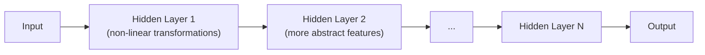
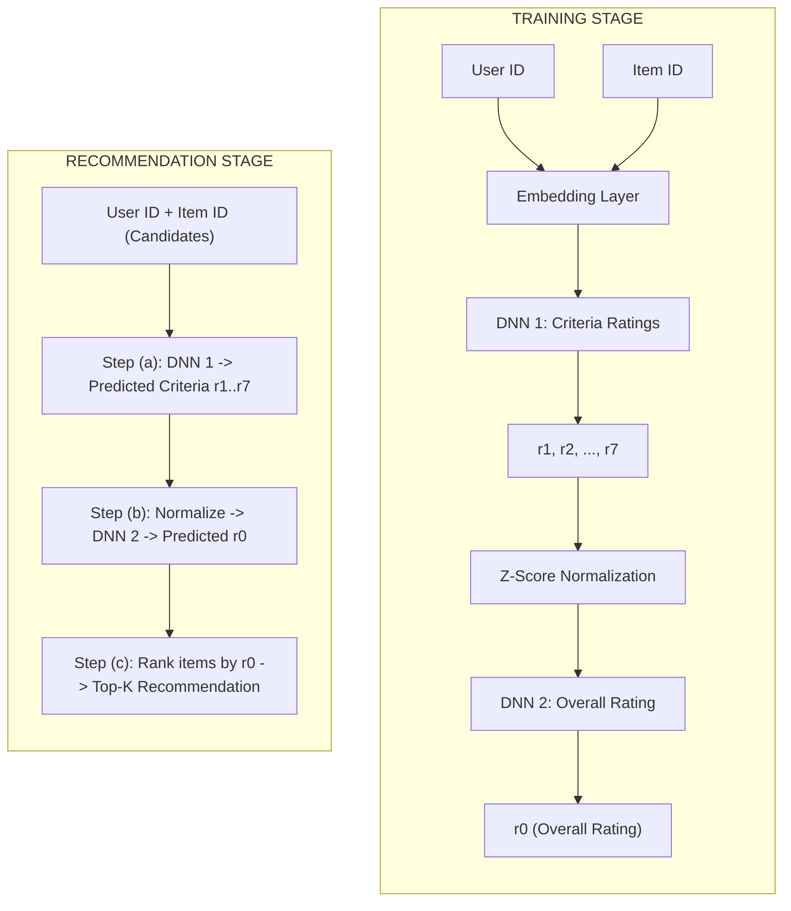
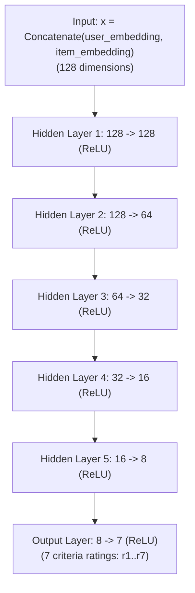
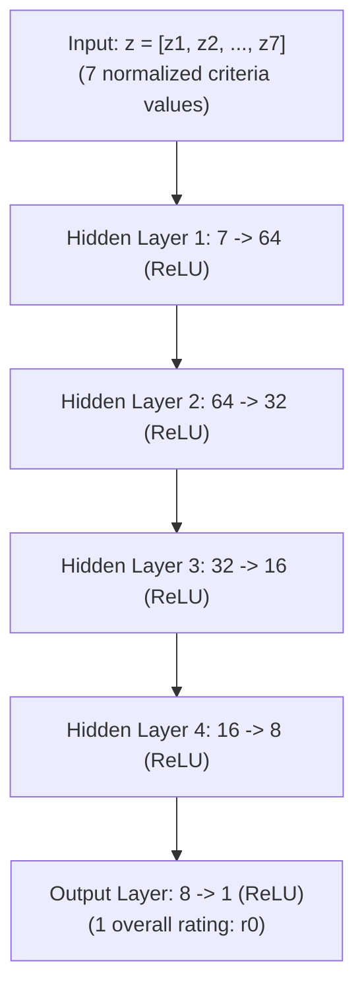
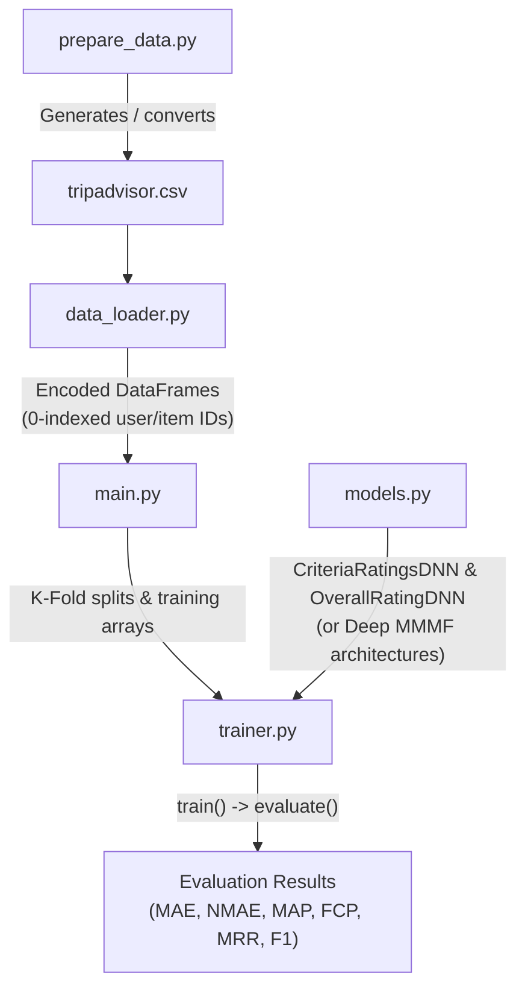

# Deep Multi-Criteria Collaborative Filtering � Complete Guide

> **Paper Reference**: Nassar, N., Jafar, A., & Rahhal, Y. (2020).  
> *A novel deep multi-criteria collaborative filtering model for recommendation system.*  
> Knowledge-Based Systems, 187, 104811.

---

## Table of Contents

1. [What is a Recommender System?](#1-what-is-a-recommender-system)
2. [The Problem with Single Ratings](#2-the-problem-with-single-ratings)
3. [Multi-Criteria Ratings](#3-multi-criteria-ratings)
4. [Collaborative Filtering](#4-collaborative-filtering)
5. [What is Deep Learning and Why Use It?](#5-what-is-deep-learning-and-why-use-it)
6. [The Proposed Model: Architecture Overview](#6-the-proposed-model-architecture-overview)
7. [Concept 1 � Embedding Layers](#7-concept-1--embedding-layers)
8. [Concept 2 � Criteria Ratings DNN (Stage 1)](#8-concept-2--criteria-ratings-dnn-stage-1)
9. [Concept 3 � Normalization](#9-concept-3--normalization)
10. [Concept 4 � Overall Rating DNN (Stage 2)](#10-concept-4--overall-rating-dnn-stage-2)
11. [Concept 5 � Loss Function: MAE](#11-concept-5--loss-function-mae)
12. [Concept 6 � Optimizer: Adam](#12-concept-6--optimizer-adam)
13. [Concept 7 � The Recommendation Pipeline](#13-concept-7--the-recommendation-pipeline)
14. [Dataset: TripAdvisor](#14-dataset-tripadvisor)
15. [Evaluation Metrics](#15-evaluation-metrics)
16. [Experiments and Settings](#16-experiments-and-settings)
17. [Results Summary](#17-results-summary)
18. [Project File Structure](#18-project-file-structure)
19. [How to Run](#19-how-to-run)
20. [Frequently Asked Questions](#20-frequently-asked-questions)

---

## 1. What is a Recommender System?

A **recommender system (RS)** is a software tool that predicts what items a user might like and suggests them.

| Platform | What it recommends |
|---|---|
| Netflix | Movies and TV shows |
| YouTube | Videos |
| Amazon  | Products |
| Spotify | Songs and playlists |
| Google  | Search results and ads |

The core idea: **if user A and user B rated many things similarly in the past, A is likely to like what B rated highly**.

---

## 2. The Problem with Single Ratings

Most recommender systems use a **single overall rating** (e.g., 1-5 stars).

**Limitation**: A single number cannot capture WHY a user liked or disliked something.

Example: Two users both give a hotel **3 stars overall**.
- User A: Hated the service (1 star) but loved the location (5 stars)
- User B: Liked the rooms (4 stars) but found it overpriced (2 stars)

Same overall rating, very different preferences � bad recommendations if treated alike.

This is why the paper proposes using **multi-criteria ratings** for better accuracy.

---

## 3. Multi-Criteria Ratings

Instead of one number, users rate an item on **multiple criteria** (sub-aspects).

For the **TripAdvisor hotel dataset** used in this paper, users rate 7 criteria:

| # | Criterion | What it measures |
|---|---|---|
| 1 | **Value** | Was the price worth it? |
| 2 | **Rooms** | Quality of the room |
| 3 | **Location** | How convenient is the hotel location? |
| 4 | **Cleanliness** | How clean was the hotel? |
| 5 | **Check-in / Front Desk** | How was the check-in experience? |
| 6 | **Service** | Quality of hotel staff and service |
| 7 | **Business Service** | Facilities for business travelers |

Plus one **Overall** rating � the single summary rating (what the model ultimately predicts).

The model goal: **predict the overall rating using all 7 criteria ratings as intermediate steps**.

---

## 4. Collaborative Filtering

**Collaborative Filtering (CF)** is the most widely used RS technique. It works purely from **user-item interaction data** (ratings) without needing to know anything about item content.

### How it works:
```
User A rated: Hotel X -> 5 stars, Hotel Y -> 3 stars
User B rated: Hotel X -> 5 stars, Hotel Y -> 3 stars, Hotel Z -> 4 stars

-> A and B have similar taste
-> Recommend Hotel Z to User A (since B liked it)
```

### Two main types:
1. **Neighborhood-based**: Find similar users or items and use their ratings directly.
2. **Model-based**: Learn a predictive model from the ratings data. (This paper uses this.)

### Key challenge:
Traditional CF methods (like SVD) use **matrix factorization** � they represent users and items as vectors and predict ratings via dot products. This is **linear** and cannot capture complex, non-linear relationships.

**Deep learning** solves this by learning non-linear patterns.

---

## 5. What is Deep Learning and Why Use It?

**Deep Learning (DL)** uses multi-layer neural networks to learn complex patterns from data.



### Why DL for recommender systems?
- Can capture **non-linear** relationships between users and items
- Can learn **complex interaction patterns** that linear methods miss
- Has shown success in NLP, computer vision, speech recognition � and now RS

### The paper's key contribution:
**First work to combine multi-criteria ratings + deep learning + collaborative filtering**

---

## 6. The Proposed Model: Architecture Overview

The model has **two stages** that are trained **separately**:



This matches the **aggregation-function-based approach** by Adomavicius et al.:

```
r0 = f(r1, r2, ..., r7)
```

where `f` is the aggregation function **learned by the neural network**.

---

## 7. Concept 1 � Embedding Layers

### The Problem with Raw IDs

User IDs and Item IDs are just integers (e.g., User 1042, Hotel 73). You cannot feed raw integers into a neural network meaningfully � there is no logical relationship between integers that the network could use.

### The Solution: Embeddings

An **embedding layer** is a **trainable lookup table** that maps each integer ID to a dense floating-point vector:

```
User ID 1042  ->  [0.12, -0.34, 0.88, 0.01, ..., -0.56]   <- 64-dimensional vector
User ID  503  ->  [0.44,  0.22, -0.11, 0.73, ...,  0.18]   <- 64-dimensional vector
```

These vectors are randomly initialized and **updated during training** to encode the user's or item's latent preferences (hidden features).

### In code (models.py):
```python
self.user_embedding = nn.Embedding(num_embeddings=num_users, embedding_dim=64)
self.item_embedding = nn.Embedding(num_embeddings=num_items, embedding_dim=64)
```

### Why 64 dimensions?
The paper tested sizes [8, 16, 32, 64, 128] and found **64 gives the best results** (Fig. 4 in the paper).

### Concatenation � Equation (1):
After getting user vector v_u and item vector v_i, they are **concatenated**:
```
x = [v_u | v_i]    (size: 64 + 64 = 128 values)
```
This combined vector x is the input to the first hidden layer.

---

## 8. Concept 2 � Criteria Ratings DNN (Stage 1)

### Architecture



### What each layer does:

**Linear transformation**: h = W * h_prev + b
- W = weight matrix (learned during training)
- b = bias vector (learned during training)

**ReLU activation**: ReLU(z) = max(z, 0)
- Makes the network **non-linear** (key advantage over linear models)
- Without ReLU, stacking many linear layers is still just one linear layer
- ReLU on the output ensures predictions are **non-negative** (ratings cannot be below 0)

### Paper Equations:

Equation (1) � Input:
```
x = Concatenate(v_u, v_i)
```

Equation (3) � Hidden layer computation:
```
h_l = ReLU(W_l * h_{l-1} + b_l)
```
where l is the layer index and h_1 = x.

Equation (4) � Output layer:
```
y_ui = ReLU(W_L * h_{L-1} + b_L)
```

Equation (5) � Final prediction:
```
[r1, r2, ..., r7]^T = y_ui
```

### Why this configuration [128->64->32->16->8]?
The paper tested many configurations (Table 4). Going too few layers (e.g., [8]) gives high MAE. Going too many (e.g., adding 256) also hurts due to overfitting. The [128->64->32->16->8] configuration gives the best MAE of **0.7552**.

---

## 9. Concept 3 � Normalization

### Why Normalize?

Neural networks are **sensitive to the scale of inputs**. If features have very different ranges, the network disproportionately focuses on the larger-scale feature.

The paper says: "DNNs are sensitive to the inputs distribution and scaling".

### Z-Score Normalization � Equation (7):

```
z_i = (r_i - mean) / std_dev
```

For each of the 7 criteria ratings:
- **Subtract the mean**: Centers the data around 0
- **Divide by std dev**: Scales to unit variance

### Example:
```
Criteria "Value" ratings: [1, 3, 5, 4, 2, 5, 4, ...]
Mean = 3.2, Std = 1.4

z = (4 - 3.2) / 1.4 = 0.57   <- normalized value
z = (1 - 3.2) / 1.4 = -1.57  <- normalized value
```

### IMPORTANT: Compute stats on TRAINING data only!
```python
# Correct approach: use training stats to normalize both train and test
mean, std = compute_normalization_stats(train_criteria)
train_normalized = normalize_criteria(train_criteria, mean, std)
test_normalized  = normalize_criteria(test_criteria, mean, std)  # use SAME mean/std
```

Never compute normalization statistics on test data. That would leak test information into training, giving artificially better results.

---

## 10. Concept 4 � Overall Rating DNN (Stage 2)

### Architecture



### What it learns:
This DNN learns the **aggregation function** f such that:
```
r0 = f(r1, r2, ..., r7)
```

The intuition is that the overall rating is NOT just a simple average of criteria. For example:
- A business traveler might weigh "Business Service" more heavily
- A family tourist might weigh "Location" and "Cleanliness" more
- These different weights are learned automatically from data

### Two DNNs trained separately:
The paper says: "trained separately without knowing each other."

1. Train DNN 1 (Criteria) using TRUE criteria ratings as targets
2. Train DNN 2 (Overall) using TRUE normalized criteria ratings as inputs

During **recommendation**, DNN 1's **predicted** criteria are fed into DNN 2.

---

## 11. Concept 5 � Loss Function: MAE

**Mean Absolute Error (MAE)** measures the average difference between predicted and true ratings:

```
MAE = (1/N) x sum(|r_ui - r'_ui|)
```

Where:
- N = number of ratings in the test set
- r_ui = true rating from user u for item i
- r'_ui = predicted rating

### Why MAE (not MSE)?
- MAE is **more robust to outliers** than Mean Squared Error (MSE)
- MAE gives equal weight to all errors, while MSE penalizes large errors more
- MAE is the standard metric in RS research

### MAE as the training loss:
During training, the optimizer minimizes MAE. After each batch:
1. Compute predicted ratings
2. Compute MAE loss
3. Backpropagate gradients
4. Update weights to reduce MAE

---

## 12. Concept 6 � Optimizer: Adam

**Adam** (Adaptive Moment Estimation) is the optimizer used in the paper.

It combines two ideas:
1. **Momentum**: Uses past gradients to smooth out updates (avoids oscillation)
2. **Adaptive learning rates**: Each parameter gets its own learning rate that adapts over time

### Paper settings from reference [36] (Kingma & Ba, 2014):
```
Learning rate : 0.001
Beta 1        : 0.9    (momentum for first moment)
Beta 2        : 0.999  (momentum for second moment)
Epsilon       : 1e-8   (numerical stability)
```

### Why Adam over other optimizers? (Paper Table 3):

| Optimizer | MAE |
|---|---|
| SGD | 3.2805 (very bad) |
| Adadelta | 0.9112 |
| Adamax | 0.7919 |
| Adagrad | 0.7565 |
| RMSprop | 0.7612 |
| **Adam** | **0.7552 (best)** |

Adam wins because it adapts to the data while maintaining good momentum.

---

## 13. Concept 7 � The Recommendation Pipeline

After training, the model follows a 3-step recommendation process (Section 3.3):

### Step (a): Compute Criteria Ratings
```
Input:  User ID + Item ID (for all unrated items)
Output: Predicted criteria ratings r'_1, r'_2, ..., r'_7
```

### Step (b): Compute Overall Rating
```
Input:  Normalized predicted criteria ratings z'_1, z'_2, ..., z'_7
Output: Predicted overall rating r'_0
```

### Step (c): Provide Recommendation
```
Input:  Predicted overall ratings r'_0 for all candidate items
Output: Top-K items with highest predicted overall rating
```

### In code (trainer.py -> predict_overall_rating()):
```python
# Step (a): CriteriaRatingsDNN prediction
predicted_criteria = criteria_model(user_ids, item_ids)

# Step (b): Normalize and OverallRatingDNN prediction
criteria_normalized = (predicted_criteria - mean) / std
predicted_overall   = overall_model(criteria_normalized)

# Step (c): Rank by predicted_overall and recommend top-K
```

---

## 14. Dataset: TripAdvisor

The paper uses a dataset crawled from TripAdvisor.com.

### Statistics (Table 1):

| Field | Value |
|---|---|
| Number of users | 72,119 |
| Number of hotels | 1,850 |
| Number of ratings | 81,085 |
| Data sparsity | 99.94% |

**Sparsity** means 99.94% of possible (user, hotel) pairs have NO rating. This is typical in RS � most users rate a tiny fraction of all items.

### Where to get the dataset:
The dataset was crawled from TripAdvisor and is not officially released. Options:

1. Use the **synthetic dataset** generator:
   `python prepare_data.py --mode synthetic`
2. If you have a TripAdvisor JSON, convert it:
   `python prepare_data.py --mode convert_json --json_path your_file.json`
3. Use similar public multi-criteria RS datasets (Yahoo! Movies, OpenTable)

---

## 15. Evaluation Metrics

The paper uses 5 evaluation metrics (Section 4.2):

### 1. MAE � Mean Absolute Error (Equation 10)
```
MAE = (1/N) x sum(|r_ui - r'_ui|)
```
Measures raw prediction error. **Lower is better**.

### 2. F-Measure � F1 and F2 (Equations 11-13)
```
Precision = |relevant AND recommended in top-K| / |recommended in top-K|
Recall    = |relevant AND recommended in top-K| / |all relevant items|
F_beta = (1 + beta^2) x precision x recall / (beta^2 x precision + recall)
```
- **F1** (beta=1): Equal weight to precision and recall
- **F2** (beta=2): Weights recall twice as much as precision

**Higher is better**.

### 3. FCP � Fraction of Concordant Pairs (Equations 14-18)
```
FCP = n_concordant / (n_concordant + n_discordant)
```
A pair (i,j) is concordant if the model correctly predicts which item the user prefers.
**Higher is better** (0.5 = random, 1.0 = perfect ordering).

### 4. MAP � Mean Average Precision (Equation 19)
```
AP  = sum[Precision(n) x rel(n)] / min(K, |relevant items|)
MAP = mean(AP) over all users
```
Measures how well relevant items are ranked near the top. **Higher is better**.

### 5. MRR � Mean Reciprocal Rank (Equation 20)
```
MRR = (1/U) x sum(1 / rank_of_first_relevant_item)
```
Measures how high the first relevant recommendation appears. **Higher is better**.

---

## 16. Experiments and Settings

### K-Fold Cross Validation:
- **5 folds** with 80% train / 20% test split
- 1% of training set used as validation
- Results averaged over 5 folds and reported as mean +/- std

### Best Hyperparameters (from paper):

| Hyperparameter | Value | How selected |
|---|---|---|
| Embedding size | 64 | Tested [8,16,32,64,128] � see Fig. 4 |
| Hidden layers (Criteria DNN) | [128,64,32,16,8] | Tested many configs � see Table 4 |
| Hidden layers (Overall DNN) | [64,32,16,8] | Set by paper |
| Batch size | 512 | Set by paper |
| Learning rate | 0.001 | Set by paper |
| Optimizer | Adam | Tested 6 optimizers � see Table 3 |
| Loss function | MAE | Set by paper |

### Hidden layer configuration search (Table 4):

| Configuration | MAE |
|---|---|
| [8] | 3.4703 |
| [8, 16] | 3.0678 |
| [8, 16, 32] | 0.9481 |
| [8, 16, 32, 64] | 0.7776 |
| **[8, 16, 32, 64, 128]** | **0.7552** |
| [8, 16, 32, 64, 128, 256] | 0.7830 |

---

## 17. Results Summary

### Per-Criterion MAE (Table 5):

| Criterion | MAE |
|---|---|
| Value | 0.8195 |
| Rooms | 0.7612 |
| Location | 0.6581 |
| Cleanliness | 0.6324 |
| Check-in / Front Desk | 0.7582 |
| Service | 0.7401 |
| Business Service | 0.8774 |
| **Mean** | **0.7495** |

### Comparison with Baselines (Table 6):

| Metric | SVD | SVD++ | SlopeOne | Baseline | KNN | Single DNN | **Our Model** |
|---|---|---|---|---|---|---|---|
| MAE (lower=better) | 0.8071 | 0.8222 | 0.9160 | 0.8094 | 0.8115 | 0.7855 | **0.7552** |
| F1 (higher=better) | 0.8370 | 0.8390 | 0.8666 | 0.8391 | 0.8388 | 0.8572 | **0.8769** |
| F2 (higher=better) | 0.7951 | 0.7991 | 0.9248 | 0.7986 | 0.7984 | 0.9176 | **0.9295** |
| FCP (higher=better) | 0.5024 | 0.5092 | 0.5096 | 0.5025 | 0.5097 | 0.4957 | **0.5126** |
| MAP (higher=better) | 0.3935 | 0.3483 | 0.3006 | 0.3881 | 0.3865 | 0.4481 | **0.4643** |
| MRR (higher=better) | 0.7272 | 0.7513 | 0.7502 | 0.7374 | 0.7360 | 0.7244 | **0.7664** |

**Key findings:**
- Our model outperforms ALL baselines on ALL metrics
- MAE is at least **5% better** than other methods
- Two-DNN model outperforms single DNN � proving multi-criteria ratings help
- MAP is at least **7% better** than other methods

---

## 18. Project File Structure

```
Assignment-1/
|
+-- main.py              <- Entry point: runs 5-fold CV pipeline
+-- models.py            <- CriteriaRatingsDNN + OverallRatingDNN definitions
+-- trainer.py           <- Training loops + all 6 evaluation metrics
+-- data_loader.py       <- Dataset loading, encoding, splitting
+-- prepare_data.py      <- Synthetic data generator + JSON converter
+-- requirements.txt     <- Python package dependencies
+-- EXPLANATION.md       <- This file!
```

### Data flow:


---

## 19. How to Run

### Step 1: Install dependencies

Open a terminal (Command Prompt or PowerShell) in the project folder:

```powershell
pip install -r requirements.txt
```

### Step 2: Run the model

**Option A � Quick demo with synthetic data (no real data needed):**
```powershell
python main.py --demo
```

**Option B � Generate a larger synthetic dataset then run:**
```powershell
python prepare_data.py --mode synthetic --output_path tripadvisor_synthetic.csv --num_users 500 --num_items 200 --num_ratings 5000
python main.py --data_path tripadvisor_synthetic.csv
```

**Option C � Use your own TripAdvisor JSON file:**
```powershell
python prepare_data.py --mode convert_json --json_path your_tripadvisor_file.json --output_path tripadvisor.csv
python main.py --data_path tripadvisor.csv
```

Your CSV must have these columns:
```
user_id, item_id, value, rooms, location, cleanliness, checkin, service, business_service, overall
```

### Step 3: Control training epochs

```powershell
python main.py --demo --epochs_criteria 100 --epochs_overall 100
```

### Step 4: Run with GPU (automatic)

If you have an NVIDIA GPU with CUDA installed, PyTorch will automatically use it:
- GPU available -> `Using device: cuda`
- CPU only      -> `Using device: cpu`

### Expected Output:
```
Using device: cpu

Fold 1
======
  Training Criteria Ratings DNN for 50 epochs...
    Epoch [  1/50] Train MAE: 1.8432 | Val MAE: 1.9201
    ...
    Epoch [ 50/50] Train MAE: 0.8123 | Val MAE: 0.8456

  Training Overall Rating DNN for 50 epochs...
    ...

  Evaluation Results for Fold 1:
    MAE : 0.8201  (lower is better)
    F1  : 0.8512  (higher is better)
    ...

FINAL RESULTS (Mean +/- Std over 5 folds)
Metric       Our Model             Paper (Table 6)
MAE       0.8012 +/- 0.0123     0.7552 +/- 0.0050
...
```

**Note:** Results on synthetic data will differ from the paper. Use more epochs and real data for results closer to the paper.

**Tip:** To get closer to the paper's results:
`python main.py --data_path tripadvisor.csv --epochs_criteria 150 --epochs_overall 150`

---

## 20. Frequently Asked Questions

**Q: Why are my results worse than the paper?**

The paper uses the real TripAdvisor dataset (81K ratings). Synthetic data has no real patterns.
The paper likely trains for more epochs than the default 50.
Try: `--epochs_criteria 150 --epochs_overall 150` with real data.

**Q: Why are two DNNs trained separately instead of end-to-end?**

This matches the aggregation-function-based framework the paper follows.
Separate training means each DNN focuses on its own objective.
End-to-end training (training both jointly) is an interesting future experiment.

**Q: What does "sparsity 99.94%" mean?**

There are 72,119 users x 1,850 hotels = 133,420,150 possible ratings.
Only 81,085 ratings exist, so only 0.06% of entries are filled.
99.94% of entries in the user-item matrix are empty (unknown).

**Q: Why use ReLU and not Sigmoid or Tanh?**

The paper states: "ReLU is the most efficient activation function."
ReLU avoids the vanishing gradient problem (gradients go to zero for large negative inputs with Sigmoid/Tanh).
ReLU is computationally cheap: just max(z, 0).
ReLU on output ensures non-negative predictions (ratings cannot be below 0).

**Q: What is the cold-start problem?**

New users or new items have no historical ratings.
Collaborative filtering cannot make recommendations for them.
The paper mentions this model CAN be extended to handle cold-start by adding content features as additional inputs.

**Q: What is 5-fold cross-validation?**

The dataset is split into 5 equal parts (folds).
In each round, 4 folds are used for training and 1 fold for testing.
This is repeated 5 times (each fold gets to be the test set once).
Final results = average of all 5 rounds -> more reliable than a single train/test split.

